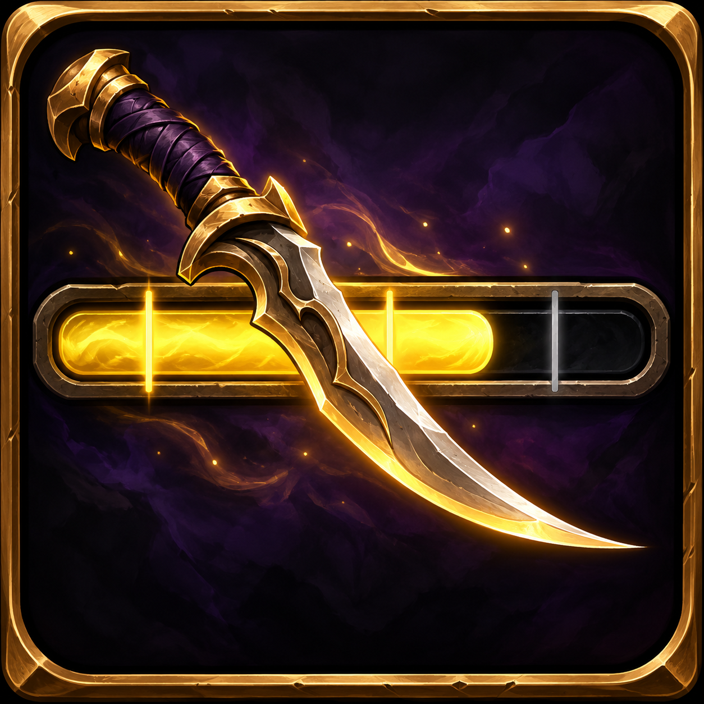

# SimpleRogueHelper - Forever

Download: [CurseForge](https://www.curseforge.com/wow/addons/simpleroguehelper-forever)

**Energy marks for rogues on WoW Forever.** On the game's own personal resource display, up to five
thin marks on the energy bar, each at the energy you set: dim below it, lit (gold) once you have that
much energy.

- **Your values**: *Mark 1* to *Mark 5* in the window, each from 1 to your maximum energy less one
  (a mark at the full bar would only light at full), or *None*. Fixed: the addon reads no spell
  cost from the game (WoW Forever's *Poised* makes it give lowered ones out of combat at full
  energy), so nothing moves them but you. Kept per character.
- **On the bar itself**: the marks belong to the game's energy bar, so they show, hide and scale with
  it. They are placed again when your maximum energy changes and when the bar is resized in Edit
  Mode; a mark at your maximum energy or above is hidden (kept for later).
- **In combat**, the game may hide power values from addons. The marks are then placed with the
  last maximum energy known (placed again after the fight) and are lit by the game itself, through
  `UnitPowerPercent` and a step colour curve; if that isn't available, from the energy, else they
  stay dim.

## Everything on the target's health bar (option)

Tick **On the target's health bar: combo points, energy and marks**, the first row of the window
(off by default). On the nameplate of the enemy you target, your combo points, centered, and an
energy bar with the same marks, right on the enemy's health bar and as wide, drawn with the game's
own art (the personal resource display's energy bar and the rogue's combo points, at the scale the
game gives them on a nameplate). Your combo points, your energy and the enemy's health are then in
one place, where the eye already is: no more looking back and forth between the enemy and the
personal resource display, which you can hide.

Its choices, under the option in the window while it is on (per character):

- **Place**: above the health bar (the default: from the top, the combo points, the energy, the
  health; clear of the character under the nameplate) or below it (the health, the energy, the
  combo points; the enemy's cast bar shows there too: widen the spacing to keep it in sight).
- **Spacing**: between the health bar and the energy, 0 to 30 (6 by default, as the personal
  resource display stacks its bars).
- **Size**: 50 % to 150 %, the combo points and the energy bar's thickness; as wide as the health bar
  whatever the size.
- **Energy value**: your energy as a number, in the middle of the energy bar, in the game's font for
  a bar's value (off by default; in combat too). On the personal resource display, the game has its
  own: *Show Bar Text* in Edit Mode.

- Shown for an enemy you target whose nameplate is shown (turn on the game's enemy nameplates); hidden
  otherwise (no target, a friend, the enemy too far or off screen).
- Above, the target's debuffs, which the game shows above its health bar, may lie over the combo
  points and the energy.
- In combat too: the energy and the combo points go to the bars as the game gives them, hidden from
  addons or not, and the marks are lit as on the personal resource display.

The addon stands alone: it works with or without Easy Controller - Forever, where it started as a
test.

## Installation

1. Download the repository (*Code > Download ZIP*) and extract it.
2. Name the folder **`SimpleRogueHelperForever`** (exact name) and put it in
   `World of Warcraft/_forever_/Interface/AddOns/`.
3. **Fully restart the game** after installing it or after an update that adds files (`/reload` does
   not load new files).

## Getting started

1. **Turn on the personal resource display**: Edit Mode, *Personal Resource Display*. The marks are
   drawn on its energy bar.
2. **Open the window** and set your marks:
   - type `/srh`;
   - or *Escape > Options > AddOns > SimpleRogueHelper - Forever > Open the configuration* (the window
     opens once the options and the game menu are closed);
   - or give it a key: *Escape > Options > Key Bindings > AddOns > SimpleRogueHelper - Forever* (no
     key by default).

## The window

| Gamepad | Mouse | |
| --- | --- | --- |
| D-pad up / down | hover | Move (held: repeats) |
| A | click a row | Check / uncheck (an option); on a value: the next one (past the highest, none) |
| D-pad left / right, on a value | wheel over it, right click | Change it (held: repeats; a right click: the value before) |
| B, Escape | the × button | Close |
| LB / RB, D-pad left / right | wheel, `<` `>` | Previous / next page (8 rows a page) |

While the window is open, these gamepad buttons are the window's; they go back to the game as soon
as it closes. A button already held when it opens (the one of its key binding, say) is taken only
once released. The window closes when a fight starts, and `/srh` is refused in combat ("Not possible
in combat").

## Languages

English, French, German, Spanish (Spain and Latin America) and Italian, following the game client's
language. Spell names are the game's.

## Saved variables

`SimpleRogueHelperCharDB`, per character: `{ values = { 25, 35, 0, 0, 0 }, hud = false, hudPos =
"above", hudGap = 6, hudScale = 1, hudText = false, version = 2 }` (`values`: the five marks' energy,
0 for none; `hud`: the option of the target's health bar, then its place, spacing, size and energy
value). A file edited by hand that holds anything else is cleaned at load.

Up to 1.1, the marks were by spell (`marks = { ["Spell name"] = true }`), at the cost the game gave.
Once, each spell marked becomes a value, its regular cost: read when Poised can't lower it (out of a
fight, the energy below full), so a character logged in at full energy gets its values after its first
ability. The five cheapest are kept; a value set meanwhile keeps the window's.

## Development

- `SimpleRogueHelperForever.toc`, `Bindings.xml`
- `Locales/*.lua`: the texts (English first, each language over it), loaded before `Core.lua`
- `Core.lua`: languages, saved variables, the combat message
- `EnergyMarks.lua`: the marks
- `TargetHud.lua`: the combo points and energy on the target's health bar (the option, its choices)
- `Window.lua`: the settings window, its gamepad bindings, its page in the game's options, `/srh`
- `tools/`: the release zip and the CurseForge upload (see *Releases*); `docs/curseforge.md`: the
  CurseForge page

### Tests

The tests run the addon's files in a small simulation of the game (Lua 5.1 through
[lupa](https://pypi.org/project/lupa/)):

```
D:\Dev\ControllerKeyboard-tests\venv\Scripts\python.exe tests\run_all.py
```

- `t01_energy_marks.py`: the marks (values set with the pad and the mouse, lit / dim, placed again,
  combat, per character, 1.1's marks by spell made values)
- `t02_window.py`: the window (D-pad, A, B, pages, held buttons, combat, mouse, options, chat,
  `Bindings.xml`)
- `t03_locales.py`: the same keys and codes in every language, the TOC
- `t04_globals.py`: no global beyond the game's needs, none of the game's replaced, nothing of Easy
  Controller - Forever's
- `t05_target_hud.py`: on the target's health bar (off at first, the game's art, the target changing,
  combat with the values hidden, place / spacing / size, the energy value, per character)

Each test's output is written to `tests/out/`.

### Releases

Every version tag pushed to GitHub (`v1.0.0`, `v1.1.0-beta1`...) runs
[.github/workflows/release.yml](.github/workflows/release.yml): it checks that the tag matches the
TOC's `## Version`, runs the tests, builds the zip (`tools/package.py`), creates the GitHub release
and uploads the file to CurseForge (`tools/release.py`), with that version's section of
`CHANGELOG.md` as its notes. A version with a `-` (`1.1.0-beta1`) goes out as a beta.

It needs the `CF_API_KEY` repository secret (a CurseForge API token) and the CurseForge project's ID
in the TOC (`## X-Curse-Project-ID`). The game version is `1.60.1` (WoW Forever) unless the
`CF_GAME_VERSION` (or `CF_GAME_VERSION_ID`) repository variable says otherwise.

To release a version:

1. Set `## Version: x.y.z` in `SimpleRogueHelperForever.toc`, and add a `## x.y.z` section at the top
   of `CHANGELOG.md`.
2. Commit, then tag and push: `git tag vx.y.z` and `git push origin main vx.y.z`.

`docs/curseforge.md` is the CurseForge project's description.

### Trying it in the game

A directory junction makes the game load the repository itself (game closed, then a full restart):

```
mklink /J "D:\Games\Battle.net\World of Warcraft\_forever_\Interface\AddOns\SimpleRogueHelperForever" "D:\Dev\SimpleRogueHelperForever"
```

**Never update the addon from the CurseForge app on an installation that uses a junction**: the app
writes through it, straight into the repository.

## License

MIT, see [LICENSE](LICENSE).
